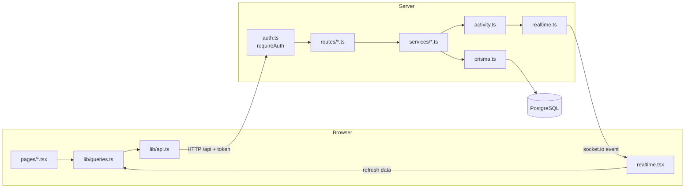
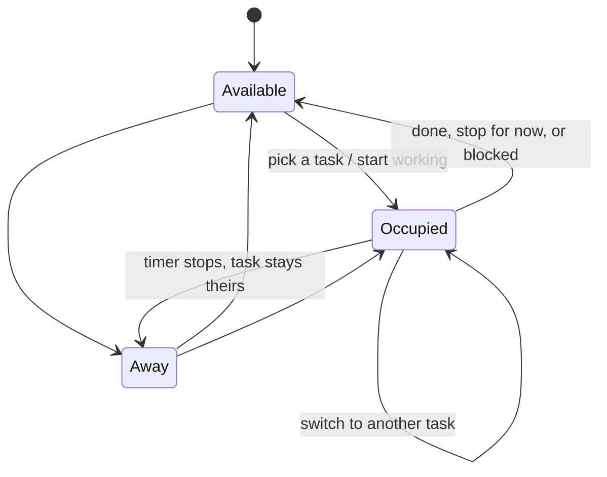

# EaseWork architecture

How the app is put together, how a request moves through it, and what every file does.
For setup and commands, see the [README](../README.md).

## The big picture

EaseWork is a **React web app** (the client) that talks to an **Express API** (the server),
which stores everything in **PostgreSQL**. It follows an MVC-style layout with an extra
service layer on the server:

| Layer | What it is | Where |
|---|---|---|
| **Model** | Database tables, defined with Prisma | `server/prisma/` |
| **Controller** | API routes: read the request, check who is asking, return JSON | `server/src/routes/` |
| **Service** | Business rules: what is allowed and what changes | `server/src/services/` |
| **View** | The React app in the browser | `client/` |

Unlike classic MVC, the server never builds HTML pages. It only sends JSON, and React
draws the screens in the browser.

## How a request flows



Example: a developer clicks **Pick up & start**.

1. The page calls `usePickUpTask()` in `lib/queries.ts`, which uses `lib/api.ts` to send
   `POST /api/tasks/:id/pickup` with the login token.
2. `auth.ts` (`requireAuth`) checks the token. `routes/tasks.ts` reads the request.
3. `services/tasks.ts` runs `pickUpTask()` in one database transaction. Only one person
   can win a race for the same task; the loser is told who got it.
4. The service writes an `ActivityLog` row. `activity.ts` publishes it, and `realtime.ts`
   pushes it to every open browser.
5. `realtime.tsx` in each browser refreshes the affected data, so the board, sheet and
   dashboard update without anyone reloading.

## Key workflows

### Developer status



- **Occupied** always means "working on a specific task", and starts a timer (a `WorkSession`).
- Going **Available** asks what happened to the task: *Completed*, *Not started / stop for
  now*, or *Blocked*. The task's status changes to match.
- **Away** stops the timer but keeps the task assigned.
- **End of day:** `services/endOfDay.ts` runs every minute. After working hours
  (`workHours.ts`, default Mon–Fri 10:00–19:00 IST) it sets developers Away, and their time
  stops at the cut-off even if the server was off at that moment.
- Code: `services/availability.ts` (`setOccupied`, `setAvailable`, `setAway`).

### Tasks, owners and collaborators

- A task has one **owner** (`Task.assignee`) and any number of **collaborators** (`TaskMember`).
- **Managers** can create tasks, assign an owner and collaborators, and edit anything.
  Developers can create their own task when they go Occupied ("Create new task").
- **Owners** can add or remove collaborators; anyone can leave a task themselves.
- **Unassigned** tasks can be picked up by any developer. They also appear under
  *Up for grabs* on My Status while the developer is not Occupied.
- **Releasing** a task hands it to the earliest collaborator, or leaves it unassigned.
- **Research** tasks are always filed under R&D Innovation (`classify()` in `domain.ts`).
- Code: `services/tasks.ts`.

### Who can see what

- Managers see every task.
- Developers see tasks they own, tasks they collaborate on, and unassigned tasks.
- The rule lives in one place, `visibleTasks()` in `domain.ts`, and every task query uses it.

### Time tracking

- Each person's work on a task is a `WorkSession` (start, end, reason it ended).
- A task's time is the sum of everyone's sessions, with a per-person breakdown on the task
  page and in the sheet.
- Code: `services/sessions.ts`.

### Documents and files

- Notes, links and file uploads are attached to a task (`TaskEntry`, `TaskLink`).
- Files are saved on disk in `server/uploads/` under random names. The limit is 25 MB and
  executable file types are blocked (`uploads.ts`).
- Downloads require login and check that the person can see the task.
- Code: `services/docs.ts`, `routes/docs.ts`.

### Claude seats

- Every developer enters the Claude seat they use. A banner reminds anyone without one.
- Input like `14`, `seat 14` or `#14` is stored as `claude-seat-14`.
- The manager's dashboard lists who uses which seat, and flags shared or missing seats.
- Code: `services/seats.ts`, `components/ClaudeSeat.tsx`.

### Live updates

- Every change writes an `ActivityLog` row inside the same transaction (`logActivity()`),
  then publishes it once saved (`publish()` in `activity.ts`).
- `realtime.ts` sends it over socket.io, and `client/src/realtime.tsx` refreshes the
  screens and shows a notice if the change concerns you.
- If the live connection drops, pages fall back to reloading every 10 seconds
  (`lib/liveRefresh.ts`).

### Slack

- `slack.ts` listens to the same activity log as live updates. When a developer becomes
  Available, or picks up a task, it posts the activity summary to one channel.
- Names in the message become @-mentions: each person's Slack account is found by their
  work email (`users.lookupByEmail`) and remembered in `User.slackUserId`.
- Messages are sent one at a time, in order. A Slack failure is logged and never blocks
  the app. Without `SLACK_BOT_TOKEN` and `SLACK_CHANNEL_ID` in `.env`, it is off.

### Backups

- The `ease-work-backup` container backs up the database and the uploads every 6 hours,
  keeping the newest 28 (`backup/backup.sh`).
- `npm run backup` takes one now; `npm run restore` restores one, taking a safety backup first.

## Every folder and file

```
ease-work/
├── package.json            commands for the whole project: dev, db:up, backup, restore…
├── package-lock.json       exact versions of every installed library (auto-generated)
├── docker-compose.yml      PostgreSQL (port 5433) + the backup container
├── README.md               setup steps, demo accounts, feature notes
├── .gitignore              files git must never commit (.env, uploads, backups…)
├── .gitattributes          line-ending settings for git
│
├── docs/
│   └── ARCHITECTURE.md     this guide
│
├── backup/                 scripts run inside the backup container
│   ├── backup.sh           every 6 h: database dump + uploads archive, keeps the newest 28
│   └── restore.sh          restores a backup (takes a safety backup first)
│
├── server/                 BACKEND: Express API on port 4100
│   ├── package.json        server libraries + commands (dev, db:migrate, db:seed…)
│   ├── tsconfig.json       TypeScript settings
│   ├── .env                secrets: DB address, JWT_SECRET, work hours (never committed)
│   ├── .env.example        the same settings without secrets, as a template
│   │
│   ├── prisma/             MODEL
│   │   ├── schema.prisma   every table: User, Project, Task, TaskMember, WorkSession,
│   │   │                   TaskEntry, TaskLink, ActivityLog
│   │   ├── seed.ts         demo data for a new database (refuses if data already exists)
│   │   └── migrations/     database changes, applied in order
│   │       ├── 20261102000000_init                    first version of all tables
│   │       ├── 20261103000000_away_and_work_sessions  Away status + time tracking
│   │       ├── 20261105000000_task_collaborators      several people per task
│   │       ├── 20261105100000_task_files              file uploads
│   │       ├── 20261105120000_claude_seats            Claude seat per developer
│   │       └── migration_lock.toml                    records that the database is PostgreSQL
│   │
│   ├── scripts/
│   │   └── local-db.ts     runs PostgreSQL without Docker
│   │
│   └── src/
│       ├── index.ts        entry point: creates the server, connects routes, starts timers
│       ├── prisma.ts       the shared database connection
│       ├── auth.ts         login tokens (JWT): signToken, requireAuth, requireRole, currentUser
│       ├── domain.ts       shared rules: task visibility, who is on a task, classification
│       ├── activity.ts     writes the activity log and publishes each change
│       ├── realtime.ts     socket.io: pushes changes to every open browser
│       ├── slack.ts        posts availability and pick-ups to a Slack channel
│       ├── uploads.ts      file storage: folder, size limit, blocked file types
│       ├── workHours.ts    office hours from .env
│       ├── lib/
│       │   └── http.ts     HttpError + the error handler that turns errors into JSON
│       │
│       ├── routes/         CONTROLLERS
│       │   ├── auth.ts     POST /api/auth/login
│       │   ├── me.ts       /api/me: profile, status, my tasks, Claude seat
│       │   ├── tasks.ts    /api/tasks: list, create, edit, pick up, join, leave,
│       │   │               hand over, status, collaborators
│       │   ├── docs.ts     notes, links, file upload and download
│       │   ├── sheet.ts    /api/sheet: spreadsheet view
│       │   └── team.ts     /api/team (dashboard, seats), /api/projects, /api/activity
│       │
│       └── services/       BUSINESS RULES
│           ├── availability.ts  Available / Occupied / Away and what happens to the task
│           ├── tasks.ts         create, update, pick up, join, release, collaborators
│           ├── sessions.ts      time tracking (open and close WorkSessions)
│           ├── docs.ts          who may add or delete docs; saving files and links
│           ├── seats.ts         seat name clean-up and clash detection
│           └── endOfDay.ts      sets developers Away after working hours
│
└── client/                 FRONTEND (VIEW): React app on port 5173
    ├── package.json        client libraries (React, Tailwind, TanStack Query…)
    ├── tsconfig.json       TypeScript settings
    ├── vite.config.ts      dev server; forwards /api and /socket.io to the API
    ├── index.html          the single HTML page React loads into
    │
    └── src/
        ├── main.tsx        entry point: React, data cache, router, toasts
        ├── App.tsx         page routes: /login, /, /board, /research, /tasks/:id, /sheet, /dashboard
        ├── auth.tsx        keeps the login token; login(), logout(), who am I
        ├── realtime.tsx    live updates: refreshes data and shows notices
        ├── index.css       Tailwind styles
        │
        ├── pages/          one file per screen
        │   ├── LoginPage.tsx      sign-in form + demo accounts
        │   ├── MyStatusPage.tsx   developer home: status, my tasks, Up for grabs
        │   ├── BoardPage.tsx      drag-and-drop board
        │   ├── ResearchPage.tsx   research tasks by stage
        │   ├── TaskPage.tsx       one task: people, time, notes, files, history
        │   ├── SheetPage.tsx      spreadsheet view + CSV export
        │   └── DashboardPage.tsx  team overview, Claude seats, activity
        │
        ├── components/     reusable pieces
        │   ├── Layout.tsx          top bar and navigation
        │   ├── ui.tsx              Button, Modal, input styles, ErrorText
        │   ├── toast.tsx           pop-up messages
        │   ├── badges.tsx          status, priority and category labels
        │   ├── TaskDialog.tsx      create / edit task form
        │   ├── ProjectDialog.tsx   create project form
        │   ├── OccupiedDialog.tsx  "what are you working on?"
        │   ├── AvailableDialog.tsx "what happened to your task?"
        │   ├── PickUpButtons.tsx   pick up / join buttons
        │   ├── OpenTasks.tsx       Up for grabs list
        │   ├── AssigneeFilter.tsx  Everyone / Mine / Unassigned filter
        │   ├── ActivityFeed.tsx    scrollable, filterable activity feed
        │   ├── ClaudeSeat.tsx      seat banner + seat dialog
        │   └── DocLink.tsx         opens or downloads a file or link
        │
        └── lib/            logic without visuals
            ├── api.ts          every server call goes through here (adds the token)
            ├── queries.ts      data hooks: useTasks(), usePickUpTask()…
            ├── types.ts        TypeScript shapes of the data
            ├── labels.ts       display text: "In progress", "2 h ago", "1.2 MB"
            ├── people.ts       who is on a task, who is working now, initials
            ├── research.ts     a research task's stage
            ├── liveRefresh.ts  how often to reload data
            └── csv.ts          builds the sheet's CSV export
```

## Where to start reading

1. `server/prisma/schema.prisma`: what data exists.
2. `server/src/index.ts`: how the server is wired.
3. `server/src/routes/tasks.ts`, then `server/src/services/tasks.ts`: one feature end to end.
4. `client/src/App.tsx`: which pages exist.
5. `client/src/pages/MyStatusPage.tsx`, then `lib/queries.ts`, then `lib/api.ts`: one
   screen from button to server.
